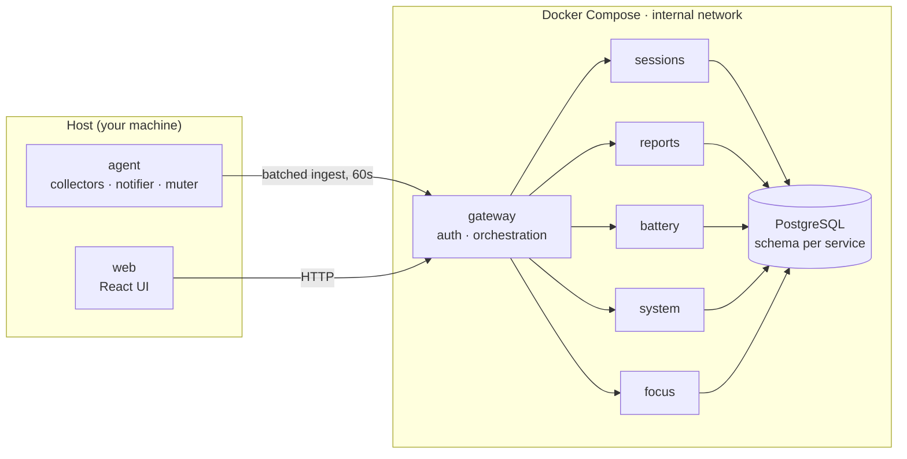

# Yoman

**Your computer's automatic diary: time, battery, load and focus. Local only.**

_Yoman_ (Hebrew for "diary") quietly records how you use your Linux machine and turns it into a calm,
readable daily journal. It tracks which apps you spend time in, how your battery is aging, when the
system is choking and why, and gives you a focus mode that silences the apps you choose.
Nothing ever leaves your computer.

> **Status:** early development. Only the repository tooling exists so far: TypeScript, Biome with
> custom security lint rules, commitlint, Vitest and a language check. The CI/CD and security gates
> come next, before any feature code. Features and Architecture below describe the design being
> built, not shipped behavior, and Security separates what is in place from what is planned. See
> the [roadmap](#roadmap).

## Features (planned)

| Area               | What it does                                                                                                                                                                                                                            |
| ------------------ | --------------------------------------------------------------------------------------------------------------------------------------------------------------------------------------------------------------------------------------- |
| **Time tracking**  | Records the focused window every few seconds, merges samples into sessions, detects idle time and screen lock, and sorts apps into categories with editable rules.                                                                      |
| **Battery health** | Tracks capacity versus design capacity, charge cycles and discharge rate over months, and shows which apps drain the battery the most.                                                                                                  |
| **System load**    | Uses Linux [PSI](https://docs.kernel.org/accounting/psi.html) to detect when the machine is actually stalling (not just busy), then names the heaviest processes and Docker containers. Also flags memory leaks and thermal throttling. |
| **Focus mode**     | Mutes notifications from selected apps (Telegram, Chrome web apps, anything installed later) for a set time. Critical alerts still get through, and you get a summary at the end. Settings survive crashes and are always restored.     |
| **Bilingual UI**   | Hebrew (RTL) and English (LTR), plus light, dark and system themes in a warm "paper and ink" design.                                                                                                                                    |

## Architecture (by design)



- **One entry point.** The UI and the agent talk only to the gateway, which orchestrates every flow.
  Services never call each other.
- **Each service owns its data.** It has its own PostgreSQL schema and its own database role, with
  no access to anyone else's.
- **The agent runs on the host**, not in a container, because it needs D-Bus, `/proc`, `/sys` and
  GNOME settings. It buffers locally, so Docker can be stopped without losing data.
- **Battery-conscious by design.** The agent targets ≤ 0.5% CPU and ≤ 60 MB of memory, and stops
  sampling while the screen is locked.

## Security

The data Yoman collects is as sensitive as browser history, so security is enforced by automation
rather than good intentions. The full threat model is in [`docs/SECURITY.md`](docs/SECURITY.md).

**In place today**

- Lint rules (Biome plus custom GritQL rules) make `npm run check` fail on spawning through a
  shell, on importing anything from `node:child_process` other than `execFile` and `spawn`, on interpolated
  SQL in `query`/`execute` calls, and on `eval` and `dangerouslySetInnerHTML`.
- npm install scripts are disabled (`ignore-scripts=true`), and every dependency is pinned to an
  exact version.
- `.env` files, local data and key material are git-ignored.

**Planned (wave 0, before any feature code)**

- gitleaks on every commit and in CI.
- CI that blocks merges on CodeQL, npm audit, actionlint
  and a suite of behavioral security tests.
- Containers with no route to the internet (only web and gateway, on loopback).

**By design (built with the features)**

- Only two ports are published, and both are bound to `127.0.0.1`. Everything else stays on an
  internal Docker network.
- The gateway defends against CSRF and DNS rebinding with a Host allowlist, Origin checks,
  `SameSite=Strict` cookies and CSRF tokens.
- Containers run as non-root with a read-only filesystem, all capabilities dropped and
  `no-new-privileges`.
- Secrets are generated locally and never committed.

## Tech stack

**In place:** Node.js 22, TypeScript (strict), zod, Vitest, Biome (lint, format and custom GritQL
security rules), commitlint

**Planned:**

- **Backend:** Fastify, pino, PostgreSQL 16
- **Frontend:** React, Vite, TanStack Query, react-i18next
- **Agent:** Node.js with D-Bus (GNOME Shell, Mutter, freedesktop notifications)
- **Testing:** fast-check, Playwright
- **Delivery:** Docker Compose, GitHub Actions

## Repository layout

Directories marked _(planned)_ do not exist yet. Each one is created by the task that first needs it.

```
apps/                (planned)
  agent/         host process: collectors, notifier, muter, tray, CLI
  gateway/       the only public API; auth and orchestration
  web/           React UI
services/        sessions · reports · battery · system · focus (planned)
packages/        shared contracts and the service kit (planned)
biome-plugins/   custom GritQL lint rules
scripts/         repo tooling
tests/           cross-cutting security and end-to-end tests (planned)
docs/            specification, design system, security model, task plan
```

## Development

Today the repository only needs Node.js 22. Running the app will also need Docker Engine with
Compose v2, and GNOME on Wayland with the
[Window Calls](https://extensions.gnome.org/extension/4724/window-calls/) extension.

```bash
npm ci
npm run hooks:install   # commit-message checks (install scripts are disabled, see .npmrc)
npm run check           # lint, typecheck, format and language checks
npm test                # unit tests with coverage thresholds
```

Commits follow [Conventional Commits](https://www.conventionalcommits.org/). commitlint checks them
in the `commit-msg` hook today, and CI will check every commit in a pull request (planned).

## Run

```bash
npm start       # creates .env if missing, builds and starts the stack, waits until it is healthy, prints the web URL, then runs the agent in this terminal
npm stop        # stops the stack (the data stays in the Docker volume)
```

`npm start` needs Docker Engine with Compose v2. Ctrl+C stops the agent, and the stack keeps running until `npm stop`. To run only the agent against a running stack: `npm run agent:dev`. The agent reads `AGENT_TOKEN` from `.env` (that key only) or from its environment, and `~/.config/yoman/agent.json` for optional settings (`gatewayUrl`, `logLevel`, `logFormat`).

## Logs

Every container prints one readable line per request, tied together by a request id (`reqId`): the agent, the gateway and each service log the same id for one request. Set `LOG_FORMAT=json` in `.env` for JSON lines instead (the default is `pretty`). Titles, command lines, tokens and cookies are never logged.

```
docker compose logs -f                                   # everything
docker compose logs -f gateway                           # one service: gateway sessions reports battery system focus web postgres
docker compose logs | grep req-7f3a                      # one request, end to end
npm run logs [-- <service>]                              # JSON lines (LOG_FORMAT=json) pretty-printed, service as a column
docker compose logs -f --no-log-prefix gateway | npx pino-pretty --minimumLevel error   # errors only (LOG_FORMAT=json)
```

Errors only with the default format: `docker compose logs -f | grep -E 'ERROR|WARN'`. A failed API answer carries its id in `error.requestId` and the `x-request-id` header; use it with `grep`.

`npm start` runs the agent in its own terminal for now (or `npm run agent:dev` alone). Once it runs as a systemd user unit, follow it with `journalctl --user -u yoman-agent -f`.

## Roadmap

Work is split into six waves so several contributors can work in parallel without touching the
same files:

0. **CI/CD and security gates** (in progress)
1. Contracts and infrastructure
2. Independent units: services, collectors and UI components
3. Integration: gateway flows, notifications, muting and pages
4. Polish: Pomodoro, tray, CLI, export and retention
5. Release: end-to-end tests, DAST, battery budget and security review

## License

All rights reserved. This repository is shared for portfolio purposes.
